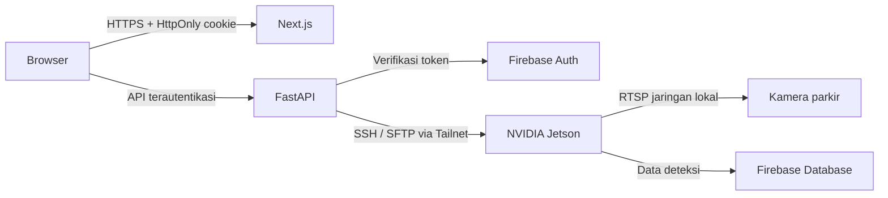

<p align="center">
  
</p>

<h1 align="center">BRIN Edge Computing</h1>

<p align="center">
  Website internal untuk memantau NVIDIA Jetson, melihat kamera parkir, dan menjalankan deteksi kendaraan tanpa harus SSH.
</p>

<p align="center">
  
  
  
  
</p>

---

## Apa yang dapat dilakukan?

Satu dashboard tanpa sidebar: panel **Jalankan deteksi**, **Kamera**, dan **Kondisi perangkat** tampil bersama. Header menampilkan logo dan judul BRIN dalam blok biru di kiri; UI tidak menampilkan kode atau penjelajah berkas.

- **Jalankan deteksi** — pilih Kamera 1 atau Kamera 2 untuk menjalankan detektor host yang diizinkan. Kamera 1 memakai `Test19Agus_optimized_fps_big_ui.py`, Kamera 2 memakai `test.py` dengan argumen tetap `2`. Hanya satu proses deteksi berjalan pada satu waktu; nama file dan argumen tidak ditampilkan di UI.
- **Kamera** — pemilih Kamera 1, 2, dan 3 untuk gambar berkala serta Real-Time Cam MJPEG channel `101` HD dalam tampilan penuh.
- **Kondisi perangkat nyata** — menampilkan GPU, suhu, memori, penyimpanan, uptime, status ketiga kamera, dan latensi.
- **Firebase Authentication** — sesi HttpOnly yang dapat diperbarui dan tetap aktif setelah browser ditutup.
- **Petunjuk pengguna baru** — tur tiga langkah yang tersimpan secara lokal pada setiap browser.

## Arsitektur aman



Browser tidak pernah menerima SSH key, kredensial kamera, URL RTSP, service-account Firebase, atau akses shell bebas. Semua operasi sensitif berada di FastAPI dan dibatasi ke workspace Jetson yang dikonfigurasi.

## Struktur proyek

```text
apps/
├── api/                    # FastAPI, Firebase session, SSH/SFTP, kamera, deteksi
│   ├── app/
│   └── tests/
└── web/                    # Next.js UI, petunjuk, unit test, Playwright E2E
    ├── e2e/
    ├── public/
    └── src/
```

## Deploy dengan Docker di Jetson

Repository menyertakan deployment ARM64 dengan Next.js, FastAPI, dan Caddy. Kamera serta proses deteksi tetap berjalan pada host Jetson; container API terhubung kembali melalui SSH yang dipin.

Panduan deployment manual: **[deploy/README.md](deploy/README.md)**

Panduan CI/CD GitHub Actions dan deployment otomatis: **[deploy/CI-CD.md](deploy/CI-CD.md)**

```bash
cp deploy/jetson.env.example deploy/jetson.env
# Isi konfigurasi privat, lalu:
docker compose --env-file deploy/jetson.env up -d --build
```

Hanya Caddy yang dipublikasikan. Container API dan web tidak membuka port langsung ke jaringan.

## Menjalankan di lokal

### 1. Tools

- Node.js 24 (sesuai CI dan image produksi)
- Python 3.11+
- Akses Tailnet menuju Jetson
- SSH private key khusus backend
- Firebase project dengan provider **Email/Password** aktif

### 2. Backend

```powershell
cd apps/api
python -m venv .venv
.venv\Scripts\python.exe -m pip install -r requirements.txt
Copy-Item .env.example .env
```

Isi `apps/api/.env` dengan alamat Jetson, lokasi key, Firebase Web API key, project ID, dan email operator. Jangan commit file `.env` atau private key.

```powershell
.venv\Scripts\python.exe -m uvicorn app.main:app --reload --port 8000
```

### 3. Frontend

```powershell
cd apps/web
npm ci
Copy-Item .env.example .env.local
npm run dev
```

Buka [http://localhost:3000](http://localhost:3000).

### Preview perubahan sebelum deploy

Untuk konfigurasi lokal yang sudah tersedia, buka dua terminal PowerShell. Jangan menyalin ulang `.env.example` ke `.env` atau `.env.local` karena dapat menimpa konfigurasi privat yang sudah benar.

Terminal backend:

```powershell
cd C:\Kuliah\WebsiteBRINSSH\apps\api
.venv\Scripts\python.exe -m uvicorn app.main:app --reload --host 127.0.0.1 --port 8000
```

Terminal frontend:

```powershell
cd C:\Kuliah\WebsiteBRINSSH\apps\web
npm run dev -- --hostname 127.0.0.1 --port 3000
```

Buka `http://localhost:3000`, login seperti biasa, dan tinjau dashboard. Pastikan `apps/web/.env.local` menggunakan `NEXT_PUBLIC_API_URL=http://localhost:8000`; backend lokal menggunakan `FRONTEND_ORIGIN=http://localhost:3000` dan `AUTH_COOKIE_SECURE=false` untuk HTTP lokal. Jangan mengubah cookie HTTPS produksi.

Perubahan frontend langsung terlihat lewat hot reload. Server lokal tidak mengganti container Jetson atau URL produksi. Namun backend lokal tetap mengakses Jetson nyata: klik **Jalankan deteksi kendaraan** hanya jika memang ingin memulai proses, termasuk kemungkinan penulisan ke Firebase.

Preview tidak memerlukan commit atau push. Jika deployment otomatis aktif, push/merge ke `main` dapat memperbarui produksi setelah CI berhasil, jadi lakukan hanya setelah menyetujui preview.

Untuk memeriksa tata letak tanpa kredensial login, jalankan `npm run test:e2e` tanpa `BRIN_E2E_PASSWORD`. Test browser memakai respons API contoh (bukan bypass autentikasi aplikasi) dan menyimpan screenshot desktop/mobile di `apps/web/test-results/`. Gambar dan metrik pada screenshot test bukan data perangkat aktual.

## Variabel penting

| Variabel | Keterangan |
|---|---|
| `JETSON_HOST` | IP Tailnet Jetson |
| `JETSON_PRIVATE_KEY` | Path private key backend |
| `JETSON_KNOWN_HOSTS` | Path `known_hosts` yang dipin |
| `JETSON_WORKSPACE` | Satu-satunya root workspace yang boleh dibaca |
| `FIREBASE_WEB_API_KEY` | Web API key Firebase Authentication |
| `FIREBASE_PROJECT_ID` | Firebase project ID |
| `FIREBASE_ADMIN_EMAIL` | Email Firebase yang dipetakan ke username operator |
| `AUTH_COOKIE_SECURE` | Wajib `true` saat menggunakan HTTPS produksi |
| `CAMERA_IP` | Alamat Kamera 1 (`10.21.1.92`); kredensial tetap dibaca dari konfigurasi host yang diizinkan |
| `CAMERA_2_IP`, `CAMERA_3_IP` | Alamat Kamera 2 dan 3 (`10.21.1.93`, `10.21.1.94`) |
| `CAMERA_2_USERNAME/PASSWORD`, `CAMERA_3_USERNAME/PASSWORD` | Kredensial privat kamera tambahan; hanya disimpan di `.env` lokal atau `deploy/jetson.env`, tidak pernah di frontend/Git |
| `CAMERA_MAX_LIVE_VIEWERS` | Batas total stream MJPEG bersamaan untuk semua kamera; default `4` |
| `NEXT_PUBLIC_API_URL` | URL FastAPI yang diakses browser |

Lihat `.env.example` pada masing-masing aplikasi untuk daftar lengkap. Saat deploy, simpan seluruh alamat, cache frame, username, dan password kamera tambahan hanya pada `deploy/jetson.env` privat sebelum membangun ulang layanan API. Backend mengakses kamera tanpa mengirim kredensial atau URL RTSP ke browser. Deteksi tersedia untuk Kamera 1 dan 2; Kamera 3 hanya untuk pemantauan. Pemilih kamera deteksi terpisah dari pemilih feed kamera. Konfigurasi website tidak mengubah script deteksi host. Detektor Kamera 2 memakai mask `/home/jetson/BRIN RI NDIP/A_Mobil_Positions/mobil_positions_cam_2.pkl` dan Firebase `slot_parking_cam2` / `slot_history_cam2`. `Mobil_Pos_cam2.py` dan `mobil_positioning_2point_line_2.py` adalah editor mask, bukan detektor; keduanya tidak boleh dijalankan lewat endpoint deteksi.

## Pengujian

```powershell
# Backend
cd apps/api
.venv\Scripts\python.exe -m pytest -q

# Frontend
cd apps/web
npm run lint
npm run typecheck
npm test
npm run build

# E2E terautentikasi (password hanya diberikan saat menjalankan test)
$env:BRIN_E2E_PASSWORD="<temporary-test-password>"
npm run test:e2e
Remove-Item Env:BRIN_E2E_PASSWORD
```

## Keamanan Website

Kontrol yang sudah tersedia meliputi:

- Firebase token verification dan cookie `HttpOnly`, `SameSite=Strict`.
- Rate limit percobaan login gagal.
- CORS origin terbatas dan security headers/CSP.
- Path traversal, symlink, jenis file, ukuran file, model, credential, serta secret filtering.
- Hanya satu script deteksi yang diizinkan dan satu proses deteksi pada satu waktu.
- Known-host verification untuk mencegah SSH man-in-the-middle.
- Snapshot cache, health cache, dan directory cache untuk mengurangi beban ketika banyak pengguna membuka dashboard.

Satu akun Firebase dapat memiliki banyak sesi browser secara bersamaan. Sekitar 20 pengguna dapat membuka dashboard dan operasi baca bersamaan, tetapi pipeline MJPEG 1080p bukan sistem broadcast: default-nya dibatasi ke **4 penonton Real-Time Cam** sekaligus untuk melindungi Jetson. Gunakan WebRTC/media server jika semua pengguna harus menonton video langsung secara bersamaan.

### Checklist produksi

- Gunakan HTTPS dan set `AUTH_COOKIE_SECURE=true`.
- Jalankan Next.js/FastAPI di server yang selalu aktif dalam Tailnet.
- Letakkan reverse proxy dengan batas ukuran request dan connection timeout.
- Ganti password awal dan idealnya gunakan akun individual untuk audit per pengguna.
- Batasi Firebase API key pada API yang diperlukan di Google Cloud Console.
- Jangan expose port FastAPI, SSH, atau kamera ke internet publik.
- Jalankan dependency audit dan backup Firebase secara berkala.
